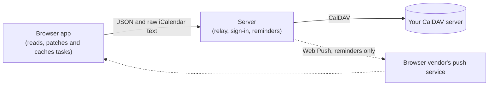

# Architecture

caldav-tasks-web is a small server and a browser app. Your CalDAV server stays the one source of
truth. This page describes what the code does today; the paths point at where to read it.

## The server is a relay

`apps/server` is a Hono app in one container. It does four things:

- **Signs the owner in.** One password, checked against `OWNER_PASSWORD_HASH`, and a signed cookie
  that expires after 30 days. There is no session table; `docs/self-hosting.md` says what ends a
  session. Everything under `/api` except sign-in needs the cookie, and a write needs a request from
  the app's own address.
- **Relays CalDAV** (`apps/server/caldav`). It lists the calendars that can hold tasks, lists the
  tasks in one, creates, updates and deletes one task, and creates, renames, recolours and deletes
  a list. A task travels as raw iCalendar text with its `href` (its address on the CalDAV server) and
  its `etag` (a version marker the server changes on every write). The relay does not parse the text,
  and the server never edits a task or writes one on its own. Every address the browser sends must be a calendar the relay listed
  or a task directly inside one; anything else is refused before a request leaves the server. The
  etag the browser sends is passed through unchanged, so a stale one comes back as `412` and the
  server never overwrites a newer version.
- **Serves the built app** and `/health`.
- **Sends reminders**, if you set that up (below).

The CalDAV password stays on the server. The browser never sees it. Logs hold an operation, a code
and a status, never a credential, a task's text or an etag.

## The browser edits a task without losing fields

The browser app (`apps/web`) makes every change to task text, using `@spy4x/time/ical` and its
`ical-tasks-*` modules. To change a task it reads the text as stored, changes only the properties
that the person edited, and writes the whole text back. Everything else in it, such as another
client's `X-` properties, its `VALARM` blocks, its `PRODID`, and properties this app does not know,
stays as it was. `apps/web/src/views/task-edit.test.ts` checks that an untouched form produces no
edit and that only changed fields go in, and `e2e/tasks.e2e.ts` checks against Radicale that a saved
edit keeps a reminder and an unknown property on the server.

The app stores things the way Tasks.org does: a list is a CalDAV calendar, a tag is a
`CATEGORIES` value, a subtask points to its parent with `RELATED-TO`, manual order is
`X-APPLE-SORT-ORDER`, priority is 1, 5, 9 or 0, and a repeating task is one task whose dates move when
you complete it.

When a save meets a `412` (someone changed the task since this browser read it), the app reads the
fresh copy, applies the same edit to it and tries once more. If the person and the other client
changed the same field, it stops and reports a conflict instead of choosing for them
(`apps/web/src/state/tasks.test.ts`).

## The offline cache and the queue of writes

The browser keeps a copy of your lists and tasks in IndexedDB (`apps/web/src/state/db.ts`) as
`{ href, etag, ics }`. On start it shows that copy first, then refreshes. It refreshes again when
the page is shown, when the network returns, and every 30 seconds while the page is visible
(`state/sync.ts`). A list whose change marker (ctag) has not moved is not fetched again.

A write that cannot reach the server goes into a queue in IndexedDB (`state/outbox.ts`), and the
screen shows the change at once. When the network returns, the queue is sent before the refresh:

- Two edits to one task wait as one write. A task created and deleted offline is never sent. A
  create whose answer was lost is not made twice when it is sent again.
- Each queued write remembers the etag it was made on. If the server's copy has changed, the write
  becomes a **conflict** and waits for a choice: **Keep mine** sends your version over the server's,
  **Use theirs** drops your edit. A task deleted elsewhere can only be discarded. Nothing is
  overwritten without that choice.
- A server that is down, or a refused account, keeps the write queued; a refusal that will not pass
  becomes a conflict. The queue survives a reload (`state/offline-writes.test.ts`).

A service worker caches the app's page and files so the app opens offline. It never caches `/api`
or `/health`.

## The reminder runner

Reminder notifications are optional (`apps/server/push`). With the five variables set, a runner in
the server wakes once a minute and reads every open task in every list that can hold tasks, over
CalDAV, only to find reminders that came due since the last run. It pushes each one once to every
subscribed browser, and the notification opens that task. It never writes a task. To do that the server
parses each task's text for its title and reminders; this is the only place the server looks inside
a task.

A list the server is refused for good (forbidden, gone, malformed) is skipped while the others are
read, and logged as a count and error codes, never a name. A timeout, a network error or a server
error on any list, or no readable list at all, sends nothing that minute, and the runner tries the
same stretch of time again, so no reminder is lost.

The one file the server writes is `push.json` in `DATA_DIR`. It holds the push subscriptions, and the
runner's "last run" time and which reminders were sent (task id and time, no task text). A data
folder that cannot be used turns notifications off with one log line and does not stop the server.

## What is deliberately out

- **Several users.** One install is one owner and one CalDAV account. Run a second install for a
  second person.
- **A server database.** The server keeps no tasks, no accounts and no sessions. Your CalDAV server
  has the tasks, the browser has its cache and queue, and `push.json` is the only server state.
- **Moving a task between lists** is refused for now (`state/tasks.test.ts`).
- **A repeat rule the library cannot reproduce** is shown as "Complete this one in Tasks.org" instead of
  being completed here, so a rule is never rewritten wrongly (`libs/tasks/identity.test.ts`).
